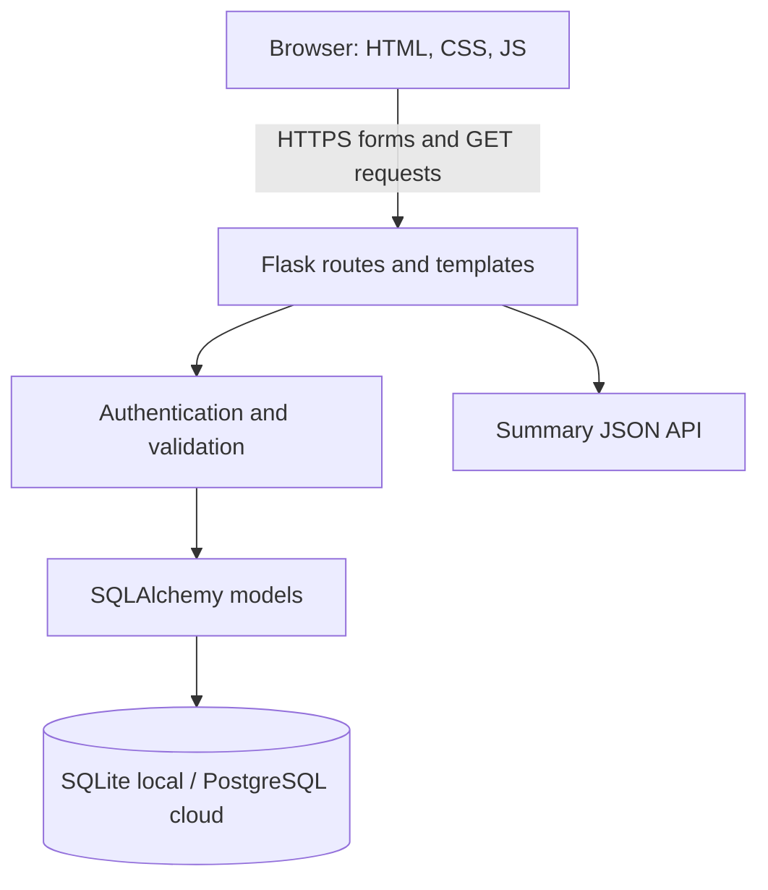
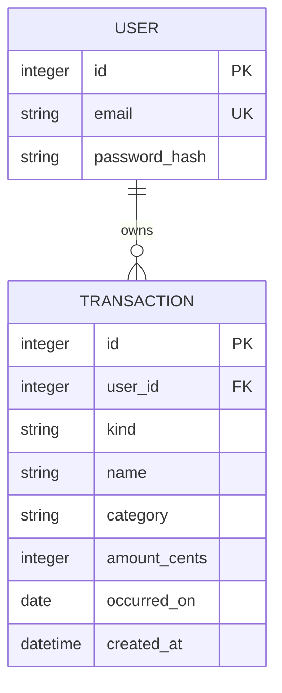

# Budget Compass — individual project specification

## 1. Opportunity and product vision

Students with part-time income and changing expenses can lose track of small purchases when entries are scattered across notes or spreadsheets. A single, simple dashboard can help them record activity and see their monthly balance without manual formulas.

**Moore's product vision template**

> **FOR** students who manage irregular income and everyday expenses, **WHO** need a quick, understandable view of their money, **THE** Budget Compass **IS A** cloud-based budget tracking web app **THAT** records transactions and shows balances and spending by category. **UNLIKE** a collection of notes or a manually maintained spreadsheet, **OUR PRODUCT** keeps each student's entries in an account and updates summaries as entries change.

**Scope:** Educational budget tracking, not banking, financial advice, or payment processing. Users should use sample data for public demonstrations.

## 2. Persona

**Maya Johnson**, a 19-year-old student who works part time. She receives income at irregular intervals and pays for food, transport, and school materials. She usually checks her balance on a phone between classes. Maya wants to add an expense quickly, review how much she has spent in a month, and keep a CSV backup of her entries. This persona is fictional.

## 3. Scenarios

**Scenario A — Record spending after class:** Maya signs in, chooses Expense, enters “Lunch,” $12.50, Food, and today's date, then submits. The dashboard shows the entry and recalculates expenses and balance. If she entered $21.50 by mistake, she edits the amount and sees the corrected total.

**Scenario B — Review a month and save a copy:** At month end, Maya selects the month on the dashboard. She sees income, expenses, balance, and category totals for that month. She filters transactions to Food, then downloads a CSV for the whole selected month. The downloaded file contains only her entries.

**Scenario C — Bring prior entries into the app:** Maya chooses a CSV with the documented columns. The app validates every row before saving any. If a row has an invalid amount, she sees the row number, fixes the file, and imports again.

## 4. User stories and acceptance criteria

| ID | User story | Acceptance criterion |
| --- | --- | --- |
| US1 | As a student, I want to create an account and sign in so my entries stay in my own space. | Registration stores a password hash; valid credentials open the dashboard. |
| US2 | As a student, I want to add income and expenses so I can record my money activity. | A valid entry appears in my list and affects totals. |
| US3 | As a student, I want to view my income, expenses, and balance so I understand my position. | Dashboard and summary API report correct totals in cents. |
| US4 | As a student, I want monthly and category views so I can focus on one period or spending area. | Month filter changes totals; category filter changes the list; sorting works. |
| US5 | As a student, I want to correct or delete a transaction so mistakes do not remain in my history. | Edits and deletes immediately update totals; other users cannot reach my entry. |
| US6 | As a student, I want to import a CSV so I can bring in existing entries. | Valid rows import together; any invalid row rejects the whole file. |
| US7 | As a student, I want to download my transactions so I can keep a portable copy. | CSV contains only my entries, optionally limited to one month. |
| US8 | As a student, I want my account data kept separate so another user cannot view or change my entries. | Queries and mutation routes enforce ownership; unauthenticated API calls return 401. |

## 5. Architecture

The browser receives server-rendered pages. Flask checks the signed session, validates CSRF tokens for changes, validates input, and scopes transaction queries to the signed-in user. SQLAlchemy maps users and transactions to SQLite locally or PostgreSQL in the cloud. Gunicorn serves Flask in the Docker container. All currency is stored as integer cents to avoid floating-point rounding in totals.

### Database design

`email` is unique. Each transaction belongs to exactly one user. Passwords are stored as hashes. The app creates tables on startup for the initial version; a future schema change would require migrations.

### Route and API design

| Method and path | Purpose | Access |
| --- | --- | --- |
| `GET /` | Landing page | Public |
| `GET/POST /register`, `/login` | Account registration and sign in | Public |
| `POST /logout` | Sign out | Signed in, CSRF |
| `GET /dashboard` | List, filter, sort, totals, category view | Signed in |
| `POST /transactions` | Create entry | Signed in, CSRF |
| `GET/POST /transactions/<id>/edit` | Edit owned entry | Signed in, CSRF on POST |
| `POST /transactions/<id>/delete` | Delete owned entry | Signed in, CSRF |
| `POST /transactions/import` | Atomic CSV import | Signed in, CSRF |
| `GET /transactions/export.csv` | CSV download | Signed in |
| `GET /api/summary?month=YYYY-MM` | JSON totals in cents | Signed in; 401 otherwise |
| `GET /health` | Database reachability | Public |

Example JSON: `{"month":"2026-09","income_cents":20000,"expenses_cents":1250,"balance_cents":18750,"by_category_cents":{"Food":1250}}`.

## 6. Implementation, testing, and deployment evidence

- Source: Flask app, responsive templates, SQLAlchemy models, Dockerfile, Render Blueprint, and README are included.
- Automated tests: `python -m unittest discover -s tests -v` covers the eight stories through six functional test cases. Record the final count from a fresh run before submission.
- Version control: commits record initial app implementation and later documentation and fixes. Push to a student-owned GitHub repository and add its real URL below.
- Docker build: run `docker build -t budget-compass .` on a machine with Docker and record the result. Run the image with a volume and test `/health`.
- Public deployment: deploy the Blueprint to Render, use PostgreSQL, open the public URL, and test a real account and transaction end to end.

**GitHub URL:** Pending creation and verification.  
**Public product URL:** Pending deployment and verification.  
**Docker build and deployed smoke test:** Pending Docker/cloud access.

## 7. Challenges and lessons learned

The prior static budget prototype held the interface concept but did not provide account-level database storage. Moving the data to a server required authentication and ownership checks on every entry. Storing money as integer cents avoided rounding errors. CSV import needed whole-file validation so a bad row could not leave a half-imported result. Keeping the cloud database separate from the container's filesystem matters because a redeploy can replace the container. The deployment and public test still need to be carried out before describing those steps as complete.

## 8. Ten-minute demo outline

| Time | Demonstration |
| --- | --- |
| 0:00–1:00 | Explain the opportunity, persona, and product vision. |
| 1:00–2:00 | Show the browser, Flask, and database architecture. |
| 2:00–3:00 | Register or sign in with a demo account. |
| 3:00–5:00 | Add an income and an expense; explain updated totals and category view. |
| 5:00–6:30 | Filter by month/category, edit an amount, and delete a test entry. |
| 6:30–7:30 | Export CSV and import a prepared sample file. |
| 7:30–8:30 | Show the JSON summary endpoint and explain account separation. |
| 8:30–10:00 | Show automated tests, Dockerfile, GitHub commits, and the live public URL; discuss lessons. |
